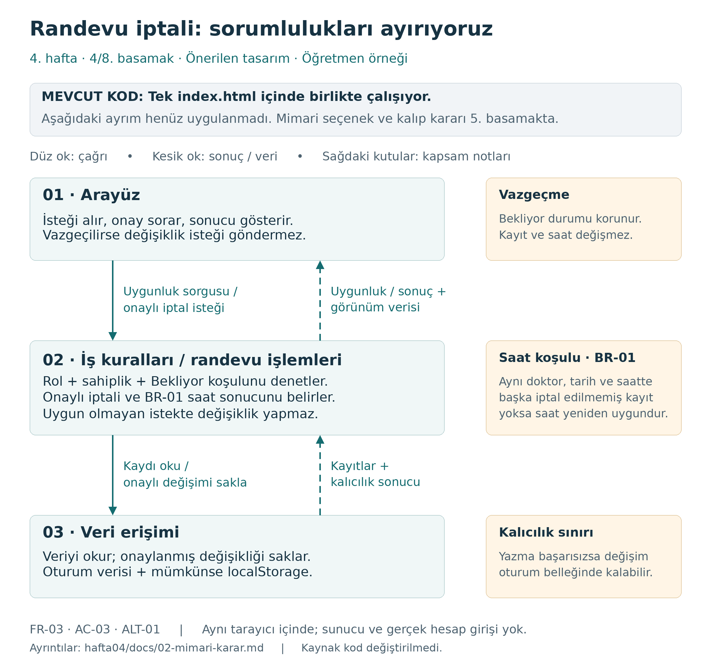

# 4. hafta — Mimari karar

Tarih: 1 Kasım 2026

Durum: Dördüncü basamağın senaryo ve sorumluluk ayrımı öğretmen örneği olarak hazır.
Beşinci basamağın mimari karşılaştırması ve tasarım kalıbı kararı henüz yapılmadı.
Bağımsız ekip incelemesi bekliyor.

İncelenen uygulama: Üçüncü hafta sonu `index.html`,
`da3ce51798344a6fafaee89cce42aa9aba90de17` commit'i.
Dördüncü hafta dalında uygulama kodu bu sürümle aynıdır.

## Senaryo ve gereksinim

**Senaryo:** Hasta, kendi Bekliyor randevusunun iptalini onaylar veya işlemden vazgeçer.
Bu senaryo üçüncü haftadaki açıklama ve onay metni çalışmasını sürdürür.
Yeni bir randevu, gerçek hesap girişi, sunucu veya ortak veritabanı eklemiyoruz.

| Kaynak | Bu çizimde korunacak davranış |
|---|---|
| [FR-03](../../docs/03-gereksinimler.md) | Yalnız Hasta rolü, seçili hastaya ait Bekliyor kaydını onayla iptal eder. Tamamlandı ve İptal edildi kayıtlarına yeni iptal uygulanmaz. |
| [FR-01 ve BR-01](../../docs/03-gereksinimler.md) | Saatin durumu doktor + tarih + saate göre belirlenir. İptal edilmiş kayıt saati engellemez; başka iptal edilmemiş kayıt varsa saat uygun sayılmaz. |
| [AC-03](../../docs/04-kabul-kriterleri.md) | Onaylanan iptalde kayıt silinmez, İptal edildi durumuyla listede kalır. Koşullar uygunsa saat yeniden Uygun görünür. |
| [ALT-01](../../docs/04-kabul-kriterleri.md) | Onay penceresindeki İptal seçeneği işlemden vazgeçirir; Bekliyor durumu ve saat korunur. |
| [H3-AC01–H3-AC05](../../hafta-03/docs/04-kabul-ve-dod.md) | İptal koşulları, Tamamlandı sınırı ve onay seçeneklerinin açıklaması korunur. İptalde toplam kayıt sayısı değişmez. |

Bu kaynaklardaki eski gözlemler yeniden çalıştırılmış test sonucu değildir.
Aşağıdaki değerlendirme kaynak kodun okunmasına ve mevcut belgelere dayanır.

## Mevcut kod ile öneri arasındaki fark

**Mevcut durum:** Arayüz, iş kuralları ve kayıt işlemleri aynı [index.html](../../index.html)
içindedir. `cancelAppointment` kaydı bulur, `canCancel` ile koşulu denetler,
`window.confirm` ile onay sorar, durumu değiştirir, `saveData` ve `render` çağırır;
son olarak `notify` ile mesaj verir. `saveData` da `renderStorage` çağırarak ekrana
ulaşır. Dolayısıyla bugün üç bağımsız bileşen oluşturulmuş değildir.

**Öneri:** Aynı tarayıcı uygulamasında üç sorumluluğun sınırını belirliyoruz.
Arayüz kullanıcıyla konuşacak; iş kuralları işlemin uygunluğunu ve sonucunu
belirleyecek; veri erişimi okuma ve saklamayı yürütecek. Okların gösterdiği çağrı
ve sonuçlar henüz uygulanmış bir API değildir. Mimari seçeneği beşinci basamakta,
koda aktarımı beşinci haftada ele alacağız.

## Sorumlulukların ayrılması

| Sorumluluk | Bu senaryoda ne yapar? | Neyi başka bileşene bırakır? |
|---|---|---|
| **Arayüz** | Rol/hasta seçimini ve randevu kimliğini alır. Uygunluk sonucuna göre işlemi gösterir, onayı sorar. Vazgeçmede değişiklik isteği göndermez. Sonuca göre listeyi, saati, izin verilen toplamları ve kaydetme durumunu gösterir. | İptal yetkisini ve durum geçişini kendisi kararlaştırmaz; doğrudan kayıt değiştirmez veya localStorage yazmaz. |
| **İş kuralları / randevu işlemleri** | Kaydı veri erişiminden ister. Kayıt var mı, rol Hasta mı, kayıt seçili hastanın mı ve Bekliyor mu denetler. Onaylı istekte koşulları yeniden kontrol eder; uygunsa Bekliyor → İptal edildi değişimini hazırlar ve saklama ister. BR-01'e göre saat durumunu, liste kapsamını ve ilgili sayıları hesaplar. | Onay penceresi açmaz, DOM çizmez; localStorage ayrıntısını bilmez. Kaydetmenin kalıcılık sonucunu veri erişiminden alır. |
| **Veri erişimi** | Randevu verisini okur; onaylanmış değişikliği oturum verisine uygular ve mümkünse tarayıcının localStorage alanına yazar. Okuma/yazma ve kalıcılık durumunu döndürür. | Kimin iptal edebileceğine karar vermez; onay veya bildirim göstermez, saat uygunluğu kuralını belirlemez. |

Buradaki rol ve hasta kimliği eğitim simülasyonundan gelir. Bu ayrım gerçek kimlik
doğrulaması veya sunucu tarafında erişim güvenliği sağlamaz.

### Mevcut işlevlerin önerilen karşılıkları

| Bugünkü kod | Önerilen sorumluluk | Ayrılırken dikkat edilecek nokta |
|---|---|---|
| Olay dinleyicisi, `window.confirm`, `notify`, `render*` | Arayüz | İşlem sonucu ve görünüm verisini kullanır. DOM üretirken iş kuralı tekrar yazılmaz. |
| `canCancel`, `cancelAppointment` içindeki koşul ve durum geçişi | İş kuralları | `cancelAppointment` bütünüyle tek kutuya taşınmaz; onay, kayıt ve çizim işleri ayrılır. Düğmenin gizlenmesi tek kontrol değildir. |
| `occupiedAt`, `scopedAppointments`; görünüm işlevlerindeki kapsam, durum ve sayı hesapları | İş kuralları | Saatin doluluğu, hastanın listesi ve doktor/tarih toplamları farklı kapsamlardır. Sonucu arayüz gösterir. |
| `loadData`, `saveData`, bellek içindeki `data` | Veri erişimi | `saveData` içindeki ekran çağrısı ayrılır. Saklama durumu sonuç olarak üst bileşene bildirilir. |
| `validateData` | Veri erişiminde okuma kontrolü ve iş kuralları | Bugünkü işlev hem veri biçimini hem iptal edilmemiş çakışan kayıtları kontrol ediyor. Biçim kontrolü veri erişiminde; BR-01 denetimi ortak iş kuralında kalmalı. |

İş kuralları için veri erişiminden gelen kayıt üzerinde değişiklik hazırlamak,
reddedilen bir istekte paylaşılan kaydı yanlışlıkla değiştirmemelidir. Veri biçimi,
işlev adları ve modül dosyaları bu çizimde kesinleştirilmedi.

## Bileşen diyagramı ve okların anlamı

[Düzenlenebilir çizim](../diagrams/01-bilesen.drawio) ·
[Düzenleme ve kontrol notu](../diagrams/README.md)

| Yön | Taşınan bilgi |
|---|---|
| Arayüz → İş kuralları | Uygunluk sorgusu; onay verilirse randevu kimliği ve simülasyon rol/hasta bilgisiyle iptal isteği. |
| İş kuralları → Arayüz | Uygunluk/ret gerekçesi; işlem sonrası görünüm verisi ve saklamanın kalıcılık durumu. |
| İş kuralları → Veri erişimi | Gerekli kayıtları oku; yalnız geçerli ve onaylı iptal için hazırlanmış değişikliği sakla. |
| Veri erişimi → İş kuralları | Kayıtlar; saklama işleminin sonucu ve kalıcılık bilgisi. |

Düz ok çağrı, kesik ok geri dönen sonuç/veridir. Bunlar aynı uygulamanın içindeki
mantıksal iletişimi gösterir; HTTP, ayrı sunucu veya çoklu cihaz eşzamanlaması
anlamına gelmez. Veri erişiminden arayüze doğrudan çizim çağrısı önerilmiyor.

## Aynı senaryonun üç sonucu

1. **Onay:** Uygunluk denetlenir, arayüz onay sorar. Onaylı istek iş kurallarında
   yeniden denetlenir. Kayıt silinmeden İptal edildi durumuna geçirilir; saklama
   sonucu alınır. Arayüz güncel listeyi ve BR-01'e göre hesaplanan saati gösterir.
2. **Vazgeçme:** Onay penceresindeki İptal seçilir. Arayüz değişiklik isteği
   göndermez; kayıt Bekliyor ve saat Dolu kalır. Kayıt sayıları değişmez.
3. **Reddedilen istek:** Kayıt yoksa veya rol, sahiplik ya da durum koşulu
   sağlanmıyorsa iş kuralları ret döndürür. Durum değiştirilmez, kaydetme yapılmaz.

Başarılı durum değişiminde yeni kayıt oluşmaz: bekleyen bir azalır, iptal edilen
bir artar; tamamlanan ve toplam kayıt sayısı korunur. Günlük toplamlar mevcut
uygulamada Doktor/Resepsiyon görünümünde gösterilir; Hasta görünümüne yeni toplam
alanı eklemiyoruz. Kontroller farklı rollere geçilerek planlanabilir.

### Saklama sınırı

Bugünkü `saveData` kalıcı yazma başarısız olduğunda `storageAvailable` değerini
kapatır; daha önce yapılmış bellek değişikliğini geri almaz. Öneride de sonuç,
“durum bu oturumda değişti” ile “kalıcı kaydedildi” bilgisini ayırmalı; arayüz
buna göre kaydetme durumunu göstermelidir. Başarısız yazmada otomatik geri alma
veya cihazlar arasında kalıcılık bu çalışmada vaat edilmez.

### Sonraki uygulamada korunacak açıklık

Mevcut onay metni saatin açılmasını “başka iptal edilmemiş kayıt yoksa” koşuluyla
anlatırken son başarı mesajında koşulsuz “İlgili saat yeniden uygun.” yazıyor.
Normal geçerli veri akışı çakışmayı zaten engelliyor; yine de önerilen arayüz
sonuç metnini iş kurallarının hesapladığı gerçek saat durumundan üretmelidir.
Bu basamakta başarı mesajı veya uygulama kodu değiştirilmedi.

## İki mimari seçeneğin karşılaştırılması

**Beşinci basamakta doldurulacak.** Aşağıdaki seçenekler henüz değerlendirilmedi.

| Ölçüt | Seçenek A: [Adı] | Seçenek B: [Adı] |
|---|---|---|
| Sorumlulukların açıklığı | [Doldurulacak] | [Doldurulacak] |
| Bir değişikliğin etkilediği yerler | [Doldurulacak] | [Doldurulacak] |
| Test edilebilirlik | [Doldurulacak] | [Doldurulacak] |
| Ek kod ve kavram yükü | [Doldurulacak] | [Doldurulacak] |
| Mevcut küçük projeye uygunluk | [Doldurulacak] | [Doldurulacak] |

## Karar ve tasarım kalıbı

- Seçtiğimiz mimari ve gerekçesi: [Doldurulacak]
- Değerlendirdiğimiz tasarım kalıbı: [Doldurulacak]
- Bu örnekte çözmesini beklediğimiz somut sorun: [Doldurulacak]
- Sağlayacağı yarar: [Doldurulacak]
- Getireceği ek karmaşıklık: [Doldurulacak]
- Kullanma / kullanmama kararı ve gerekçesi: [Doldurulacak]
- Beşinci haftada koda aktarılacak sınırlar: [Doldurulacak]

## Kontrol

- [x] Diyagramdaki sorumluluklar FR-03, BR-01, AC-03 ve ALT-01 ile karşılaştırıldı.
- [x] Çağrı ve sonuç oklarının yönleri ve taşıdığı bilgi açıklandı.
- [x] Mevcut tek dosya ile önerilen sorumluluk ayrımı ayrı belirtildi.
- [x] `.drawio` XML yapısı ve bağlantı uçları okunarak kontrol edildi; PNG görsel olarak incelendi.
- [ ] diagrams.net arayüzünde açma/düzenleme kontrolü ve yazardan farklı kişinin incelemesi.
- [ ] Mimari seçeneklerin ve tasarım kalıbının yararı/maliyeti — beşinci basamak.

Hazırlık: Öğretmen için kaynak kod ve önceki belgelerden oluşturulmuş örnek.
Bağımsız inceleyen / geri bildirim: Henüz yok; sekizinci basamakta kaydedilecek.
Uygulamanın T01–T06 davranış testleri bu basamakta yeniden çalıştırılmadı.

Öğrenciler [boş 02 şablonunu](../sablonlar/02-mimari-karar.md) kendi gruplarında
kullanır ve kendi diyagramlarını üretir. Açıklamaları aynen kopyalamak yerine
her okun hangi bilgiyi taşıdığını ve hangi bileşenin durum değişikliğine karar
verdiğini kendi örnekleri üzerinden anlatır.
