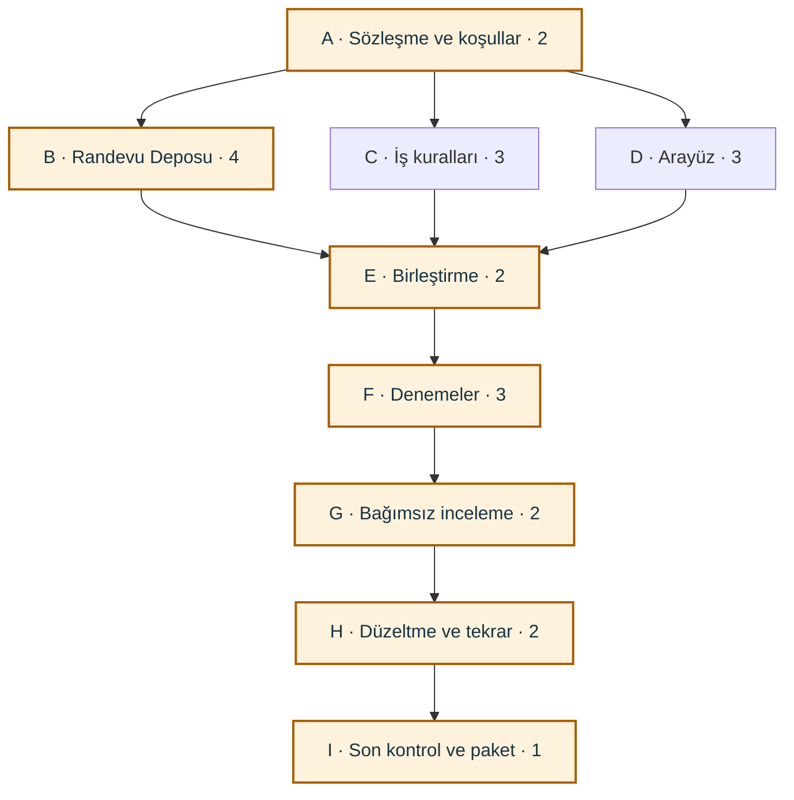

# H4-P0 — İlk iş planının sabit karşılaştırma kopyası

Tarih: 1 Kasım 2026 · Dördüncü hafta, altıncı basamak

Bu öğretmen örneği, değişiklik öncesindeki varsayımları ve hesabı korur.
Üzerine güncel plan yazılmayacak. Sonraki değişiklikler ve kontrol durumu
[03-is-plani-ve-riskler.md](../docs/03-is-plani-ve-riskler.md) dosyasında tutulacak.
Planlanan işler henüz yapılmadı; gerçek ekip ataması ve bağımsız inceleme yoktur.

## Kapsam ve varsayımlar

**Plan H4-P0**, [H4-MK-01 mimari kararını](../docs/02-mimari-karar.md) beşinci haftada
uygulamak için hazırlanmış ilk öğretmen örneğidir. Dördüncü haftanın bu basamağında
planlama yapıyoruz; aşağıdaki dokuz görev henüz yürütülmedi.

Hedef, üçüncü hafta sonundaki randevu iptalini arayüz, iş kuralları ve Randevu
Deposu sınırlarına ayırırken mevcut davranışı korumaktır. Dayanaklar
[FR-03 ve BR-01](../../docs/03-gereksinimler.md),
[AC-03 ve ALT-01](../../docs/04-kabul-kriterleri.md) ile
[H3 kabul koşullarıdır](../../hafta-03/docs/04-kabul-ve-dod.md).
Oluşturma ve tamamlama işlemlerinin aynı güncel veriyi kullanması da bütünleştirme
kontrolündedir. Yeni rol yetkisi, gerçek hesap girişi veya sunucu özelliği planlanmadı.

- **Süre birimi:** 1 çalışma bloğu = 30 dakika net çalışma. Bu birim ders saatinin
  süresini tanımlamaz; kritik yol alıştırmasının açık hesap birimidir.
- **Başlangıç:** `t=0`, uygulama çalışmasına başlanacak an. Kesin gün/saat
  belirlenmedi. Molalar, dersler arasındaki günler ve dış onay beklemeleri ayrıca
  takvime işlenecek; burada hesaplanan 8 saat kesin teslim tarihi değildir.
- **Kaynak varsayımı:** Dört kişilik örnek ekip, U1–U4. Bunlar gerçek kişi ataması
  değil, öğrencilerin kendi isimleriyle değiştireceği planlama rolleridir.
  Atanan kişi görev süresince o işe katılır; aynı anda başka işe atanmaz.
- **Beceri ve ortam varsayımı:** Hazır üçüncü hafta kodu, sentetik deneme verileri
  ve çalışan geliştirme ortamı vardır. İlgili JavaScript/DOM bilgisine sahip,
  rehberli çalışan örnek ekip varsayılmıştır. Yeni konu öğrenme veya ortam onarma
  ihtiyacı varsa süreler yeniden tahmin edilmelidir.
- **Bağımlılık varsayımı:** Bütün oklar “öncül bitsin, sonraki başlasın” anlamında.
  Ek bekleme, zorunlu bitiş tarihi veya görev bölme yoktur. B, C ve D, A'da
  belirlenen ortak sözleşme ve örnek sonuçlarla paralel hazırlanabilir; gerçek
  parçalarla birleştirme E'dedir.
- **Tahminin niteliği:** Süreler öğretim amaçlı ilk tahminlerdir; ölçülmüş öğrenci
  hızı, verilmiş taahhüt veya tamamlanmış iş süresi değildir. Üçüncü haftanın
  göreli iş puanları bu saatlere çevrilmedi.

U1 veri erişimi ve bütünleştirmeyi, U2 kurallar ve denemeleri, U3 arayüz ve
denemeleri üstlenir. U4 bu planlanan kodun yazımına katılmadan inceleme yapar.
Gerçekte bir parçanın yazımına katılırsa o parçanın bağımsız inceleyeni ayrıca
belirlenmelidir. Bu gelecek uygulama planı, H4 belgelerinin sekizinci basamaktaki
bağımsız incelemesinin yapılmış olduğu anlamına gelmez.

## İlk iş planı — H4-P0

| İş ID | Somut görev / çıktı | Öncül iş(ler) | Sorumlu(lar) | Süre: blok (saat) | Emek: kişi-saat |
|---|---|---|---|---:|---:|
| A | Ortak sözleşmeyi, örnek kayıtları ve uygulamayı açma yöntemini netleştir; deneme koşullarını yaz. | Yok | U1 + U2 | 2 (1) | 2 |
| B | Randevu Deposu erişimini hazırla: kayıt kopyası, okuma, güncelleme, eski veri biçimi ve kalıcılık sonucu. | A | U1 | 4 (2) | 2 |
| C | İptal uygunluğunu, durum geçişini ve BR-01 sonucunu ekran/kayıt ayrıntılarından ayır. | A | U2 | 3 (1,5) | 1,5 |
| D | Onay/vazgeçme, sonuç mesajı ve görünüm akışını kararlaştırılan işlem sonuçlarına bağla. | A | U3 | 3 (1,5) | 1,5 |
| E | Üç parçayı birleştir; açılışı ve oluşturma/tamamlama ile ortak güncel veri kullanımını kontrol et. | B, C, D | U1 + U2 + U3 | 2 (1) | 3 |
| F | Kabul ve sınır denemelerini çalıştır; gerçek sonuçları, kayıt kimliklerini ve bulguları kaydet. | E | U2 + U3 | 3 (1,5) | 3 |
| G | Yazarlardan farklı üye kodu, test kayıtlarını ve mimari uyumu incelesin; bulguları yazsın. | F | U4 | 2 (1) | 1 |
| H | Sınırlı bulgu düzeltmesi ve ilgili denemelerin tekrarı için ayrılan çalışma. | G | U1 + U2 | 2 (1) | 2 |
| I | İnceleyenle son durumu doğrula; uygun teslim adayını commit, test ve inceleme kayıtlarıyla paketle. | H | U1 + U4 | 1 (0,5) | 1 |

**Tahmin gerekçesi:** A'da ortak girdiler ve sonuçlar netleştirilecek. B, okuma,
güncelleme ve başarısız kalıcı yazmayı birlikte kapsadığı için dört blok ayrıldı.
C ile D'nin her biri üç blok; parçaları bağlamak E'de iki blok. F'deki üç blokta
başarılı iptal, vazgeçme, rol/sahiplik/durum reddi, saklama sınırı ve diğer
randevu işlemleriyle tutarlılık denemeleri yürütülecek. G'ye iki blok inceleme,
I'ya bir blok son doğrulama ve paketleme ayrıldı.

**H satırının anlamı:** İki blok, küçük bulguları düzeltme ve ilgili denemeleri
tekrarlama varsayımıdır; her büyüklükte hatanın bir saatte giderileceği güvencesi
değildir. Bulgu çıkmazsa kullanılmayan süre gerçek ilerlemede ayrıca gösterilir;
daha çok iş çıkarsa plan güncellenir. Başarısız kontrol veya açık engelleyici bulgu
varken I işi tamamlanmış sayılamaz.

## Bağımlılık ağı ve kritik yol

Ağ aşağıdaki Mermaid çizimidir. Her kutudaki sayı **blok süresidir**, kişi sayısı
değildir. Kritik işler renkle ve hesap tablosundaki sıfır bollukla gösterilir.

| Başlangıçtan sona yol | Süre toplamı | Sonuç |
|---|---|---|
| A → B → E → F → G → H → I | 2 + 4 + 2 + 3 + 2 + 2 + 1 = **16 blok** | Kritik yol; 8 saat |
| A → C → E → F → G → H → I | 2 + 3 + 2 + 3 + 2 + 2 + 1 = **15 blok** | 15 blok; 7,5 saat |
| A → D → E → F → G → H → I | 2 + 3 + 2 + 3 + 2 + 2 + 1 = **15 blok** | 15 blok; 7,5 saat |

**İlk kritik yol: A → B → E → F → G → H → I.** Bu yol 16 blok, yani
**8 saat net geçen çalışma süresi** verir. E'nin başlaması için B, C ve D'nin
üçünün de bitmesi gerekir. İleri hesapta E başlangıcı `max(6, 5, 5) = 6` olur.
Bu yüzden paralel kolların süreleri birbirine eklenmez.

### Erken/geç zamanlar ve bolluk

Aşağıdaki bütün sayılar `t=0` başlangıcından itibaren blok sınırıdır. Örneğin
B'nin 2'de başlayıp 6'da bitmesi dört blok, yani iki saat sürmesi demektir.

| İş ID | En erken başlangıç | En erken bitiş | En geç başlangıç | En geç bitiş | Toplam bolluk |
|---|---:|---:|---:|---:|---:|
| A | 0 | 2 | 0 | 2 | 0 |
| B | 2 | 6 | 2 | 6 | 0 |
| C | 2 | 5 | 3 | 6 | 1 |
| D | 2 | 5 | 3 | 6 | 1 |
| E | 6 | 8 | 6 | 8 | 0 |
| F | 8 | 11 | 8 | 11 | 0 |
| G | 11 | 13 | 11 | 13 | 0 |
| H | 13 | 15 | 13 | 15 | 0 |
| I | 15 | 16 | 15 | 16 | 0 |

Hesabı izlemek için: İleri yönde en erken başlangıç, öncüllerin en erken bitiş
değerlerinin **en büyüğüdür**; buna süre eklenir. Geri yönde en geç bitiş,
ardılların en geç başlangıç değerlerinin **en küçüğüdür**; süre çıkarılır.
Son işin geri hesabı 16'dan başlar.
Toplam bolluk = en geç başlangıç − en erken başlangıç. Bu tarih kısıtı olmayan
örnekte sıfır bolluklu zincir kritik yoldur. [K1]

C ve D'nin her birinde **1 blok = 30 dakika** toplam bolluk vardır. Örneğin C,
diğer koşullar aynıyken 3'te başlayıp 6'da bitebilir. Bu bir blok, görevin
atlanabileceği anlamına gelmez. C ve D'nin bolluklarını toplayıp projenin
sonuna bir saatlik ek süre diye yazamayız; ikisi de E'nin aynı başlangıcına bağlıdır.

## Süre, emek ve kaynak kontrolü

| Ölçü | İlk plan sonucu | Anlamı |
|---|---:|---|
| İş sürelerinin aritmetik toplamı | 22 blok = 11 saat | Bütün görev süreleri toplanır; paralellik hesaba katılmaz. |
| Ağın bitişi | 16 blok = 8 saat | Varsayımlar altında başlangıçtan teslim adayına kadar net geçen süre. |
| Toplam emek | 17 kişi-saat | Her işin süresi × o işteki kişi sayısı; bütün işler için toplam. |
| Takvimde teslim günü | Henüz belirlenmedi | Gerçek ders/çalışma günleri ve dış beklemeler bilinmeden tarih verilemez. |

Örnek: E bir saat sürer; üç kişi birlikte çalışır. E'nin emeği **3 kişi-saat**,
geçen süresi **1 saattir**. Bu nedenle 17 kişi-saati dört kişiye bölerek proje
bitişini hesaplamıyoruz; görev sırası ve hangi kişinin ne zaman gerektiği önemlidir.

| Örnek üye | Planlanan çalışma | Toplam emek |
|---|---|---:|
| U1 | A, B, E, H, I | 5,5 kişi-saat |
| U2 | A, C, E, F, H | 6 kişi-saat |
| U3 | D, E, F | 4 kişi-saat |
| U4 | G, I | 1,5 kişi-saat |

A'dan sonra B'yi U1, C'yi U2, D'yi U3 yürütür. 2–5 blok aralığında üç görev
paraleldir; aynı kişi iki farklı görevde değildir. 5–6 arasında B sürer;
U2 ve U3, E'nin başlaması için B'yi bekler. E, F ve sonraki işler sıralıdır.
U4'ün G ve I zamanında erişilebilir olduğu varsayılmıştır. Bu atamalarda hiçbir
blokta kişi çakışması yoktur; en fazla üç kişi aynı anda atanır.

Dört kişinin her an dolu olması hedeflenmedi. Bir üye yoksa veya aynı kişi B, C
ve D'den birden fazlasını üstlenirse paralellik varsayımı yeniden kontrol edilir.
Beş kişilik grup, beşinci üyeye somut iş atayıp tahminini güncellemelidir; üye
sayısının artması tek başına kritik yolu kısaltmaz. Kaynak uygunluğunu ağ
hesabından ayrı kontrol etmek gerekir. [K1]

## İlk risk kaydı

| Risk | İşe / bitişe etkisi | Önlem | Örnek sorumlu | İzlenecek işaret |
|---|---|---|---|---|
| Üye veya bağımsız inceleyen uygun değil. | B–D paralelliği ya da G/I başlangıcı bozulabilir. | Uygulamadan önce gerçek görev sahiplerini ve erişilebilir zamanlarını yaz; gerekirse atamaları ve hesabı yenile. | U1 | Aynı kişiye aynı zaman aralığında iki iş veya inceleyen için boş isim. |
| Ortak sözleşme eksik; parçalar farklı sonuçlar bekliyor. | E uzar; B–D'ye dönüş gerekir. | A'da kayıt kopyası, ret ve kalıcılık sonuçları için küçük örnekler üzerinde anlaş. | U1 + U2 | Arayüzün kayıt dizisini doğrudan değiştirmesi veya farklı sonuç adları kullanılması. |
| Eski veri kaybolur ya da işlemler farklı veri kopyalarını yazar. | B/E/F'de tutarsızlık; teslim engeli. | Mevcut anahtar, schema ve nextId'yi koru; sentetik deneme verisiyle iptal/oluşturma/tamamlama sırasını kontrol et. Kullanıcının verilerini sıfırlama. | U1 | İptalin geri gelmesi, kaydın silinmesi, toplamların uyuşmaması. |
| Dosyaların ayrılması uygulamayı açma yöntemini etkiler. | A veya E tahmini aşılır. | A'da yükleme yöntemini seç ve çalıştığını kontrol et; gerekirse açılış yönergesini güncelle. | U1 | Açılışta boş ekran, bulunamayan dosya veya yükleme hatası. |
| Kalıcı kayıt hatası yanlışlıkla tam başarı gibi gösterilir. | F/G'de bulgu; H'de düzeltme gerekir. | Bellek değişimi ile kalıcı yazma sonucunu ayrı dene ve göster. | U2 | Yerel kayıt başarısızken kalıcı kaydedildi mesajı görülmesi. |
| Bulgular H için ayrılan iki bloğu aşar. | 8 saatlik ilk tahmin yetmez. | Açık bulguları ve yeniden deneme işini tahmin et; kalite kontrollerini kaldırmadan planı güncelle. | U2 | H sonunda engelleyici bulgu veya başarısız kabul koşulu kalması. |
| Önceki PR'ların bağımlılığı ya da dış onay beklemesi sürer. | Paket hazır olsa da main'e birleştirme/nihai teslim bekler. | [00 belgesindeki](../docs/00-baslangic-ve-surum.md) PR ilişkilerini teslimde yeniden kontrol et; dış beklemeyi ayrıca kaydet. | U1 | Hedef dal veya önceki PR'ların durumu netleşmeden birleşmiş teslim iddiası. |

I'nin çıktısı, koşulları sağlanmış **teslim adayıdır**. Dış onay veya önceki
PR bağımlılıkları için süre varsaymadık; 8 saat bu beklemeleri kapsamaz.

## Yöntem kaynağı

**K1:** U.S. GAO, [Schedule Assessment Guide, GAO-16-89G](https://www.gao.gov/assets/gao-16-89g.pdf),
Aralık 2015. Kaynak/süre/emek için rapor sayfası 49; kritik yol için 75–89;
bolluk için 91–96; ileri/geri hesap için Ek IV, 172–180. Erişim: 1 Kasım 2026.
Burada temel hesap yönteminden yararlanıldı; bu ders örneği için GAO uygunluğu
iddia edilmez. Görevler, süreler ve kişi atamaları kendi öğretim varsayımlarımızdır.
