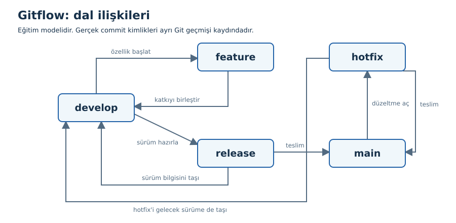

# 39 - Gitflow ve dal planı

## Başlangıç ve seçim

Kaynak: Drive'daki [26 Ekim 2026 güncel 9 haftalık plan](https://docs.google.com/document/d/1HFdiLmDmVWLQpftQFj_tgF2BcCujXHZ2/edit), H9 bölümü. Mevcut sürüm paneli laboratuvarı, düz HTML/JavaScript Klinik Randevu örneğine uyarlandı. .NET kurulumu gerekmez.

| Kapsam | Sabit kimlik | Durum |
|---|---|---|
| Klinik uygulama | 0.3.0-rc.1; H8 `a95a59b96d822f1225e4815b8c6ac4f928691cd5` | Önceki aday; H9'da uygulama kodu değiştirilmedi |
| H9 laboratuvar araçları | `901f8144b83947ec4bfc0aabad5a7f7998a24ce8` | Ayrı, gerçek Git deneyi |
| Yerel eğitim paneli | 0.9.0-dev → 0.9.0 → 0.9.1 | Kasıtlı kusurlu metin ve hotfix senaryosu |
| Gerçek GitHub çalışma dalı | `docs/h9-gitflow-teslim` | [PR #21](https://github.com/pozelll/-klinik-randevu-ogretmen/pull/21), hedef release/h8-surum-adayi |

Gitflow, planlı sürüm ve bakım düzeltmesinin ayrılmasını öğretmek için seçildi. Her ekip için zorunlu veya en iyi akış olduğu iddia edilmez. Sürekli teslim yapan küçük bir ekip daha kısa ömürlü dallarla daha basit bir akış seçebilir.

| Laboratuvar dalı | Çıkış noktası | Hedef / amaç |
|---|---|---|
| main | başlangıç | Eğitim teslim geçmişi |
| develop | main | Birleşik geliştirme |
| feature/hasta-bilgi | develop | Hasta katkısı; develop'a dönüş |
| feature/personel-bilgi | aynı develop | Personel katkısı; önce güncel develop'u alır |
| release/0.9.0 | birleşik develop | main ve develop'a sürüm bilgisini taşır |
| hotfix/0.9.1 | teslim main | main ve develop'a düzeltmeyi taşır |

## Ön hazırlık

Git ve Python 3 gerekir. Depo kökünde çalışın. Windows'ta Python komutu `py -3` olabilir. Aşağıdaki çıktı klasörü yeni/boş olmalıdır; önceki çalışma silinmez.

```bash
git --version
python --version
python hafta09/tools/gitflow_lab.py --output h9-deneyim
python hafta09/tools/surum_kontrol.py --anlam
```

İlk komut dizisi bütün senaryoyu gerçekten kurar ve doğrular. Sonraki ders basamakları üretilen geçmişi inceletir. Öğrenci katkısı otomatik deneydeki commit yazarıyla karıştırılmaz.

Paneli göstermek için ayrı terminalde depo kökünden `python -m http.server 8000` çalıştırın; tarayıcıda `http://localhost:8000/hafta09/panel/` açın. JSON fetch kullanan paneli `file://` ile açmayın. Klinik uygulama ise H8 ZIP'i ayıklanıp `index.html` açılarak çalışır. Paket içinde H8 ZIP'i ayrıca sağlanır.



Şema dal ilişkilerini anlatır. Gerçek commit geçmişi [git-gecmisi.txt](../kanitlar/git-gecmisi.txt), kimlikler [gitflow-sonuclari.json](../kanitlar/gitflow-sonuclari.json) içindedir.
