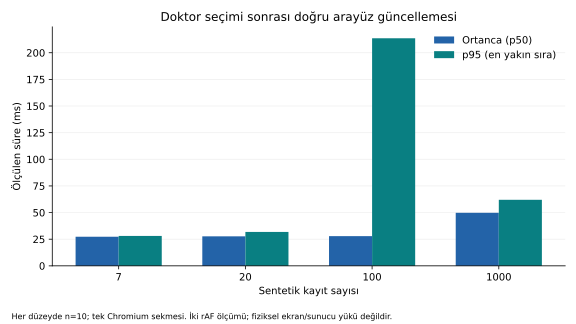

# 49 - Öğretmen projesi teknik kapanış ve kabul durumu

22 Kasım 2026. Bu kayıt önceki haftaların hazırlık anındaki açık PR/ölçülmedi ifadelerini günceller. Tarihsel dosyalar ve rc.1 kanıtları korunur.

## Birleştirme durumu

Kullanıcının inceleme ve sırayla birleştirme talimatıyla aşağıdaki sekiz PR doğrudan main'e sırayla birleştirildi. Sonraki PR, öncekinden sonra main'e hedeflendi. Merge yöntemi geçmişi koruyan merge commit oldu; dallar silinmedi.

| PR | Gerçek merge commit | Durum |
|---|---|---|
| [#7](https://github.com/pozelll/-klinik-randevu-ogretmen/pull/7) | `adff72c7230ba3f15c2943ee890cd27297c7c068` | Birleştirildi |
| [#11](https://github.com/pozelll/-klinik-randevu-ogretmen/pull/11) | `13db173248002d75eac19a825af908840b39a06a` | Birleştirildi |
| [#12](https://github.com/pozelll/-klinik-randevu-ogretmen/pull/12) | `1384a6fa37b72dd932b09467ee39c081defde699` | Birleştirildi |
| [#15](https://github.com/pozelll/-klinik-randevu-ogretmen/pull/15) | `8910057c4d8bc89a74447d627d77085128909fd6` | Birleştirildi |
| [#16](https://github.com/pozelll/-klinik-randevu-ogretmen/pull/16) | `c5b690cdb87d1f8c09a19ece45bfa1392798ea11` | Birleştirildi |
| [#18](https://github.com/pozelll/-klinik-randevu-ogretmen/pull/18) | `9e6dcef2df8bf7caf38e59b3abe9ced189542232` | Birleştirildi |
| [#19](https://github.com/pozelll/-klinik-randevu-ogretmen/pull/19) | `da08b5c7a702b8380d7fd0c9c007a7c438280625` | Birleştirildi |
| [#21](https://github.com/pozelll/-klinik-randevu-ogretmen/pull/21) | `98297352b6dd735eab0774069ab622ec45e64cc1` | Birleştirildi |

[PR #22](https://github.com/pozelll/-klinik-randevu-ogretmen/pull/22) bu kapanış kaydı, odak düzeltmesi, kalite ölçümleri ve rc.2 paketini taşır. PR'nin güncel merge/CI durumu bağlantıdan izlenir. İnceleme AI destekli teknik incelemedir; bağımsız insan onayı olarak kaydedilmedi.

## Bulunan ve giderilen iki kusur

1. Saat düğmeleri yeniden üretilirken klavye odağı kayboluyordu. Aynı saat düğmesinde odak korunur; işlemle kaldırılan veya pasifleşen düğmeden etkin bir denetime geçilir. Altı gerçek klavye senaryosu başarıyla yürütüldü.
2. Panelde surum alanı liste/nesne olduğunda doğrulayıcı TypeError ile çöküyordu. Tür denetimi eklendi; artık yapılandırılmış FAIL sonucu ve exit=1 üretir. Dört regresyon testi geçti.

## Aynı kaynağa bağlı teknik kanıt

Uygulama kaynak commit'i: `5c796623a18d4ba187d2a9fe9beba4708915360b`.

[Kalite CI 45027450559](https://github.com/pozelll/-klinik-randevu-ogretmen/actions/runs/45027450559), job 137223463407. Kaynak dosya SHA-256 değerleri her raporda bulunur. Bu kaynak rc.2 paket tanımıyla eşleşir.

| Kontrol | Gerçek sonuç | Kanıt |
|---|---|---|
| İş kuralları / veri erişimi | 30/30 Node | CI Is kurallari regresyonu |
| Panel tür hatası | 4/4 unittest | CI Panel dogrulayici regresyonu |
| Klinik tarayıcı | 14/14 | [JSON](../kanitlar/kapanis/kaynak-tarayici-sonuclari.json) |
| Gerçek Gitflow | 12/12; son senaryo 6 panel kontrolü | CI Gercek Gitflow deneyi |
| RC2 paket | 8/8; iki üretim aynı baytlar | [Paket raporu](../kanitlar/kapanis/paket-sonuclari.json) |
| Klavye | 4 temel görev + 2 ek kontrol, 6/6 | [JSON](../kanitlar/kapanis/klavye-sonuclari.json) |
| Native onay | Gerçek X11 Return/Escape; API accept/dismiss yok | JSON ve dört native PNG |
| Native görünür odak | OK düğmesinde odak halkası görüldü | [AI görsel inceleme kaydı](../kanitlar/kapanis/native-odak-gorsel-incelemesi.json) |

NFR-03 bu tek Chromium ortamında dört görevi ve görünür odak koşulunu sağladı. Bu, genel erişilebilirlik uygunluk beyanı veya insan kullanılabilirlik deneyi değildir. Native tarayıcı düğmeleri bu koşuda İngilizce OK/Cancel olarak görünür.

## Performans ve yerel veri ölçeği

Ortam: GitHub Actions Linux, Chromium; tek sekme, 1280×900. Her düzeyde 10 doktor değişimi. Ölçüm: change olayı → doğru saat/liste/toplam kontrolü → ikinci requestAnimationFrame. İki rAF fiziksel ekran ölçümü değil, boyama fırsatı yaklaşımıdır; kontrol kodunun süresi de dahildir.

| Sentetik kayıt | Deneme | p50 ms | p95 ms | Maksimum ms | Hatalı güncelleme |
|---|---:|---:|---:|---:|---:|
| 7 | 10 | 27.3 | 28.1 | 28.1 | 0 |
| 20 | 10 | 27.7 | 31.8 | 31.8 | 0 |
| 100 | 10 | 27.9 | 213.6 | 213.6 | 0 |
| 1000 | 10 | 49.8 | 62.0 | 62.0 | 0 |

[Ham örnekler ve ortam](../kanitlar/kapanis/performans-sonuclari.json) · [CSV](../kanitlar/kapanis/performans-ozet.csv)



p95 en yakın sıra yöntemiyle hesaplandı; n=10 olduğu için maksimuma eşittir. Küçük örneklemde 100 kaydın tek yüksek örneği, 1000 kayıttan büyük p95 vermiştir. Bu bir monoton ölçeklenme veya bütün cihazlar için performans garantisi değildir.

7 ve 20 kayıtta 10/10 güncelleme doğru ve 1000 ms teknik eşiğin altında. **NFR-02'nin özgün ekran kaydı/kare analizi yapılmış sayılmadı.** Hedef değiştirilmedi; yeni instrumentasyon kanıtı ayrı tutuldu. 100 ve 1000 kayıt keşifsel; kabul eşiği uydurulmadı. Seri güncelleme hızı tek sekmede otomasyon aralıklarını da içerir; sunucu kapasitesi veya eşzamanlı kullanıcı throughput'u değildir.

7/20/100 kayıtta üç oluşturma/iptal döngüsü ve yenilemede birebir veri korunması; 1000 sınırında ek kayıt reddi/veri korunması başarılı. Yenileme toparlanması çökme dayanıklılığı, yedekleme veya çoklu cihaz geri yüklemesi değildir.

## Güncel dağıtım

[Klinik_Randevu_0.3.0-rc.2.zip](../dagitim/Klinik_Randevu_0.3.0-rc.2.zip), 49.602 bayt, 9 dosya.

SHA-256: `85371dd961cee6e197158d95b68906dbaf21bf96e540fc2ef8a7b1f300feb84a`.

```bash
python scripts/check_candidate.py --profile h9
python scripts/build_candidate.py build --profile h9 --output kendi-rc2.zip
python scripts/build_candidate.py verify --profile h9 hafta09/dagitim/Klinik_Randevu_0.3.0-rc.2.zip
```

Tam ZIP'i ayıklayın; index.html ve src klasörü birlikte kalmalıdır. Native onay penceresi tarayıcının diline göre değişebilir. H9 0.9.x Gitflow paneli ayrı eğitim senaryosudur. Tarihsel H8 rc.1 paketi, manifesti ve eski PDF'ler değiştirilmedi. Güncel paket profili h9'dur; eski h8 profili ancak kendi sabit kaynağında yeniden üretilir.

## Tam kapanış için kalan gerçek kabul

| Açık iş | Tamamlanma ölçütü | Hazır kayıt |
|---|---|---|
| NFR-01 insan kullanılabilirliği | Dört farklı kişinin en az üçü iki görevi yardımsız, doğru ve görev başına ≤60 sn tamamlar | [Katılımcı CSV](../sablonlar/nfr01-katilimci-kaydi.csv) |
| NFR-02 özgün yöntem | 10 doktor değişiminin ekran kaydı/kare analizi; doğru 3 alan ve ≤1 sn | [Ekran kaydı CSV](../sablonlar/nfr02-ekran-kaydi.csv) |
| Bağımsız insan incelemesi ve alıcı kabulü | Gerçek inceleyen, tam kaynak SHA, bulgu/karar; alıcının paket erişimi ve çalıştırması | [Kabul oturumu](50-insan-kabul-oturumu.md) |

Bu sonuçlar sağlanmadığı için [#20](https://github.com/pozelll/-klinik-randevu-ogretmen/issues/20) açık tutulur. Teknik birleştirme, insan kabulü tamamlandı anlamına gelmez. Nihai klinik yayın kararı hâlâ BEKLET; öğretmen ders adayı teknik kanıtlarıyla kullanılabilir. Gerçek hasta verisi ve sunucu kimlik doğrulaması projenin kapsamı değildir.


## Ölçüm aracının tekrar koşusu

Belge güncellemesi `5526ff93af38ef14674e5f118fae1cd59584c181` için [push kalite koşusu 45032884539](https://github.com/pozelll/-klinik-randevu-ogretmen/actions/runs/45032884539), 7 kayıt düzeyini tamamladıktan sonra 20 kayıt düzeyinde mesaj içermeyen `AssertionError` ile durdu. Aynı head'in PR kalite koşusu geçti. [Başarısız koşunun özgün performans çıktısı](../kanitlar/kapanis/performans-basarisiz-tekrar.json) korunur. Eski günlük, hatanın ilk veri yükleme eşitliğinde mi yoksa yenileme eşitliğinde mi olduğunu göstermediği için kesin eski hata satırı veya kök neden iddia edilmez.

Ölçüm aracında ön-belge `init` betiği ve oturum işaretçisi kaldırıldı. Önce gerçek `file://` sayfası açılır; sentetik veri bu yerleşmiş kaynakta açıkça yazılır ve sayfa yenilenir. Ölçümden önce yalnız kayıt sayısı değil, tam başlangıç verisinin eşitliği doğrulanır. Sonraki toparlanma yenilemesi hiçbir şekilde yeniden veri kurmaz. Hata çıktısı artık aşama, kayıt düzeyi ve traceback içerir; rapor ölçüm betiğinin SHA-256 değerini de taşır.

Bu değişiklik yalnız deney hazırlığı ve teşhis kaydıdır. On doktor değişiminin tümü, aynı içerik kontrolleri, iki rAF yaklaşımı ve 7/20 kayıttaki 1000 ms eşiği korunur. Önceki başarılı sonuç tablosu kendi belirtilen koşusunun ölçümüdür; yeni head'in yürütümü PR Checks sayfasından ayrıca doğrulanır.
